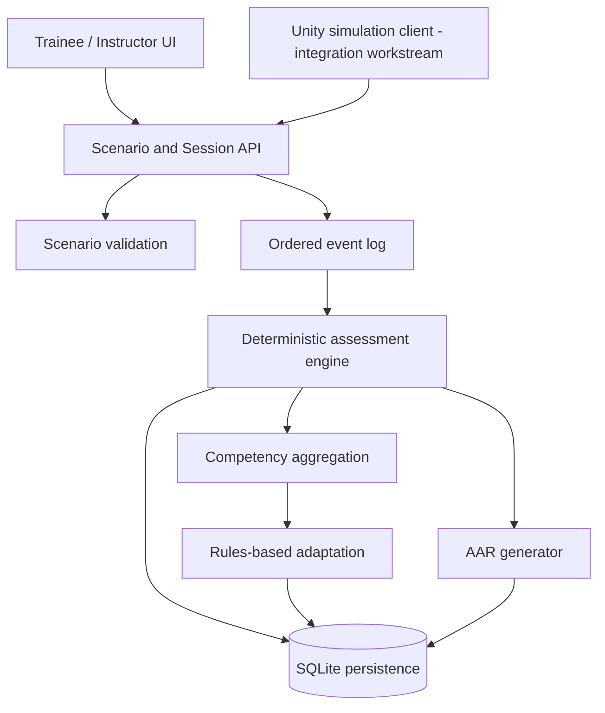

# Architecture

## Design goals

SENTINEL-X uses a local-first modular architecture. The simulation client, scenario package, assessment logic, adaptation policy, persistence, and AAR have explicit responsibilities. The first implementation favors a simple service boundary and SQLite over a distributed deployment.

## Logical components

## Component responsibilities

- **Scenario package:** versioned scenario definitions, learning objectives, public task data, and server-side evaluation metadata.
- **Scenario validation:** checks required fields, version metadata, supported observation types, and allowed parameters.
- **Session service:** creates and transitions sessions through `READY`, `RUNNING`, `COMPLETED`, and `REVIEWED` states as applicable.
- **Event log:** records monotonic sequence numbers, simulation time, type, and validated payload. Events provide the evidence base for scores and reports.
- **Scoring engine:** computes deterministic rubric dimensions and metrics; it does not call an LLM or change official grades based on free-form text.
- **Adaptation engine:** identifies adequately supported competency gaps and recommends a relevant approved exercise. It never modifies a completed score.
- **AAR generator:** summarizes recorded events, metric results, and flags. Explanations must be supported by saved evidence.
- **Persistence:** SQLite in local development; repository code isolates storage concerns for later migration.
- **Unity client:** a runtime-generated UGUI training client consumes the scenario observation and session APIs for the synthetic OBS-001 workflow. A rendered 3D environment and editor-verified build remain outstanding.

## Assessment contract

Each completed assessment references the session ID, scenario ID/version, rubric ID/version, event set, score breakdown, metrics, and any review flags. Rubric weights in the starter implementation are explicitly provisional and should be replaced only through versioned, reviewed changes.

The prototype formula is a weighted sum of normalized competency dimensions. Metric availability is represented explicitly; zero evaluated observations must not be misrepresented as perfect accuracy. Critical flags appear separately from the aggregate score. The final rubric and thresholds require domain review.

## Scenario and event contract

Scenario package structure is defined in `scenarios/schemas/scenario.schema.json` and examples live in `scenarios/approved/`. Events contain a session ID, increasing sequence number, simulation timestamp, event type, and typed payload. The service owns answer keys and compares a submission against the configured ground truth during assessment.

A random seed, scenario version, and rubric version are retained to support replay and audit. Rendering frame rate must not determine scoring.

## API surface

| Method | Path | Purpose |
|---|---|---|
| `GET` | `/health` | Process health |
| `GET` | `/api/v1/scenarios` | List scenario metadata without answer keys |
| `GET` | `/api/v1/scenarios/{scenario_id}` | Retrieve public scenario metadata |
| `GET` | `/api/v1/scenarios/{scenario_id}/observations` | Retrieve trainee prompts without answer keys |
| `POST` | `/api/v1/sessions` | Create a session |
| `POST` | `/api/v1/sessions/{session_id}/events` | Append a validated event |
| `POST` | `/api/v1/sessions/{session_id}/complete` | Complete and assess a session |
| `GET` | `/api/v1/sessions/{session_id}/assessment` | Retrieve persisted result |
| `GET` | `/api/v1/sessions/{session_id}/aar` | Retrieve event-linked AAR |
| `GET` | `/api/v1/trainees/{trainee_id}/progress` | Retrieve aggregate progress |
| `POST` | `/api/v1/recommendations` | Select targeted practice |

The API is for local development. It must not be publicly exposed until authentication, authorization, origin/network controls, request limits, secret management, and deployment hardening are implemented and reviewed.

## Persistence and data integrity

SQLite is the default for the initial offline workflow. Writes should be transactional. Repeated assessment of an already-completed session must not append duplicate events or inflate counts. Historical results retain the scenario/rubric versions used at evaluation time. Corrections should be additive/auditable rather than silently overwriting an old result.

Tables currently cover sessions, events, assessments, and recommendations. Users, formal approvals, instructor annotations, export jobs, and append-only administrative audit logs are additional deployment work, not assumed complete merely because they appear in the long-term blueprint.

## Failure behavior

- Invalid scenario: reject before session starts.
- Missing or malformed event: return a validation error; do not partially store it.
- Repeated/out-of-order event sequence: reject.
- Incomplete session: do not produce a normal completed score.
- No denominator data: return a not-available metric, not an invented numeric result.
- Persistence exception: report failure, not success.
- Insufficient competency evidence: return a conservative fallback recommendation.

## Future extensions

The boundary permits a Unity client, optional web dashboard, richer validated observation simulation, an institution-approved identity integration, and approved controller familiarization to be added later. Live systems remain outside the initial release; any future physical integration requires a separate safety and authorization process.
